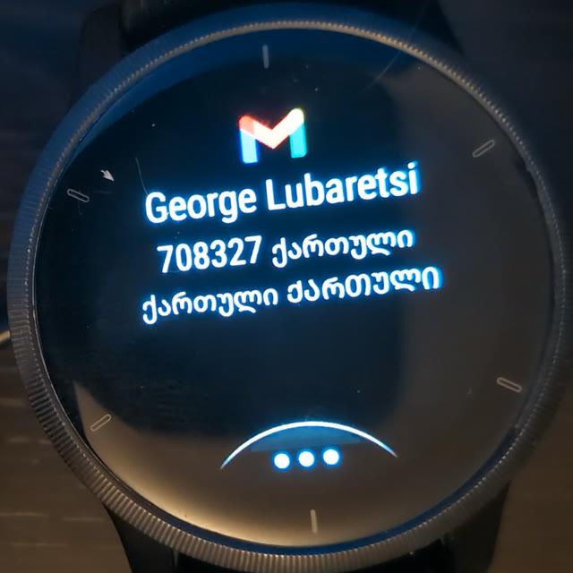
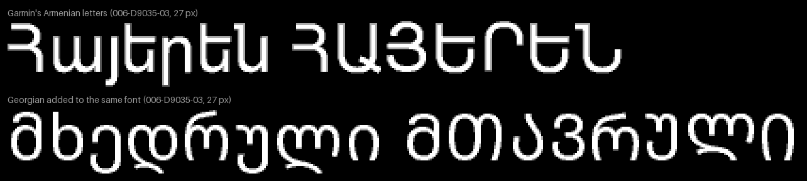

# Georgian for Garmin

ქართული შრიფტი Garmin-ის საათებისთვის.

Garmin watches show Georgian text in notifications as boxes. This project adds Georgian letters to
a font the watch already uses, so notifications from your phone show `მხედრული` and `ᲛᲗᲐᲕᲠᲣᲚᲘ`
instead of `□□□□□□□□`.

<p>
  <a href="https://github.com/lubaretsi/georgian-for-garmin/releases/latest/download/Georgian-for-Garmin-macos.zip"></a>
  <a href="https://github.com/lubaretsi/georgian-for-garmin/releases/latest/download/Georgian-for-Garmin-windows-x64-setup.exe"></a>
  <a href="https://github.com/lubaretsi/georgian-for-garmin/releases/latest/download/Georgian-for-Garmin-linux-x86_64.deb"></a>
</p>

The app isn't signed, so your computer warns the first time; [Install](#install) shows what to
click. Windows on Arm, other Linux and the command-line tools:
[all downloads](https://github.com/lubaretsi/georgian-for-garmin/releases/latest).

Installing on Windows, start to finish in 46 seconds
([step by step in Georgian](docs/install-windows.md)):

https://github.com/user-attachments/assets/c4adbad8-d956-4ab3-ba71-5f67e415e6df



*A Gmail notification on a Venu 2 (firmware 19.05).*

Unofficial; not affiliated with or endorsed by Garmin.

## How it works

Garmin watches load optional fonts for other scripts, such as Armenian, from a hidden folder. This
project takes Garmin's own Armenian font in each size, adds all 66 modern Georgian letters
(Mkhedruli and Mtavruli) and copies it to the watch over USB. The watch loads it after a
restart. Nothing else on the watch changes: no firmware update, and Armenian still works. Garmin's
original font can be copied back the same way; on the Venu 2 that restored the boxes. Details:
[How it works](docs/how-it-works.md).



Georgian is drawn at the size of the font's own letters: in the 27 px font, Georgian lowercase is
19 px tall, like the Armenian ([Size](fonts/README.md#size)).

## Supported watches

Every watch model reported to the project, from the support list in
[fonts/registry.json](fonts/registry.json); the models predicted to work, from Garmin's data or
a watch's own report, are [below](#likely-to-work-not-confirmed). "Tested" means someone
installed Georgian on that model and software version and saw it in a real notification. Follow
a watch's issue for updates.

<!-- watches: generated from fonts/registry.json by `python -m garmin_fonts.support` (from builder/); edit the registry, not this table -->
| Watch | Software | Status |
|---|---|---|
| Venu 2 | 19.05 | Tested |
| tactix 7 | 27.18 | Tested |
| Venu 2 Plus | 19.05 | Tested ([#4](https://github.com/lubaretsi/georgian-for-garmin/issues/4)) |
| fenix 7 Pro Solar, Pro Sapphire Solar | 26.09 | Tested ([#11](https://github.com/lubaretsi/georgian-for-garmin/issues/11), [#15](https://github.com/lubaretsi/georgian-for-garmin/issues/15)) |
| Forerunner 165 | 29.52 | Tested ([#5](https://github.com/lubaretsi/georgian-for-garmin/issues/5), [#18](https://github.com/lubaretsi/georgian-for-garmin/issues/18), [#19](https://github.com/lubaretsi/georgian-for-garmin/issues/19), [#22](https://github.com/lubaretsi/georgian-for-garmin/issues/22)) |
| Forerunner 165 Music | – | Not confirmed yet ([#5](https://github.com/lubaretsi/georgian-for-garmin/issues/5), [#7](https://github.com/lubaretsi/georgian-for-garmin/issues/7)) |
| Venu 3 | – | Not confirmed yet ([#5](https://github.com/lubaretsi/georgian-for-garmin/issues/5), [#2](https://github.com/lubaretsi/georgian-for-garmin/issues/2)) |
| Venu 3S | – | Not confirmed yet ([#5](https://github.com/lubaretsi/georgian-for-garmin/issues/5), [#9](https://github.com/lubaretsi/georgian-for-garmin/issues/9)) |
| Forerunner 255 | 29.52 | Tested ([#13](https://github.com/lubaretsi/georgian-for-garmin/issues/13), [#35](https://github.com/lubaretsi/georgian-for-garmin/issues/35), [#37](https://github.com/lubaretsi/georgian-for-garmin/issues/37)) |
| epix Pro (Gen 2) 51mm | 27.18 | Tested ([#46](https://github.com/lubaretsi/georgian-for-garmin/issues/46)) |
| fenix 6S Pro | 28.02 | Doesn't work ([#6](https://github.com/lubaretsi/georgian-for-garmin/issues/6), [#20](https://github.com/lubaretsi/georgian-for-garmin/issues/20)). The watch has the font file but doesn't use it for Georgian letters: they still show as question marks. |
| fenix 6 Pro Solar | 28.02 | Doesn't work ([#6](https://github.com/lubaretsi/georgian-for-garmin/issues/6), [#14](https://github.com/lubaretsi/georgian-for-garmin/issues/14)). The watch has the font file but doesn't use it for Georgian letters: they still show as question marks. |
| fenix 6X Pro | 28.02 | Doesn't work ([#6](https://github.com/lubaretsi/georgian-for-garmin/issues/6), [#3](https://github.com/lubaretsi/georgian-for-garmin/issues/3), [#24](https://github.com/lubaretsi/georgian-for-garmin/issues/24), [#25](https://github.com/lubaretsi/georgian-for-garmin/issues/25)). The watch has the font file but doesn't use it for Georgian letters: they still show as question marks. |
| Forerunner 245 | 13.70 | Doesn't work ([#16](https://github.com/lubaretsi/georgian-for-garmin/issues/16)). The app found no font on this watch it can add Georgian to: it connects only as a USB drive. |
| Forerunner 245 Music | 13.70 | Doesn't work ([#10](https://github.com/lubaretsi/georgian-for-garmin/issues/10)). Its only optional fonts are emoji fonts, which have no letters to add Georgian to. |
| fenix 5 | 25.00 | Doesn't work ([#30](https://github.com/lubaretsi/georgian-for-garmin/issues/30), [#29](https://github.com/lubaretsi/georgian-for-garmin/issues/29)). The app found no font on this watch it can add Georgian to: it connects only as a USB drive. |
| Instinct 2 Solar Tactical | 17.22 | Doesn't work ([#38](https://github.com/lubaretsi/georgian-for-garmin/issues/38)). The app found no font on this watch it can add Georgian to: it connects only as a USB drive. |
| Instinct 3 AMOLED 50mm | 15.19, 16.12 | Doesn't work ([#57](https://github.com/lubaretsi/georgian-for-garmin/issues/57), [#8](https://github.com/lubaretsi/georgian-for-garmin/issues/8), [#33](https://github.com/lubaretsi/georgian-for-garmin/issues/33)). Georgian added to its Korean 19 px font didn't show in notifications. |
| Instinct 3 AMOLED 45mm | 16.12 | Doesn't work ([#57](https://github.com/lubaretsi/georgian-for-garmin/issues/57), [#55](https://github.com/lubaretsi/georgian-for-garmin/issues/55), [#23](https://github.com/lubaretsi/georgian-for-garmin/issues/23)). Georgian added to its Korean 19 px font didn't show in notifications. |
<!-- /watches -->

Where Georgian showed: on the Venu 2, Forerunner 165, Forerunner 255, fenix 7 Pro and epix Pro
(Gen 2) 51mm in pop-ups, the notification list and opened notifications, and on the fenix 7 Pro
in incoming calls too. The Forerunner 165 was first confirmed with the TrueType fonts of the 0.3.0
beta.

It works with notifications from Android phones and from iPhones: on an iPhone-paired fenix 7 Pro,
a WhatsApp message and an incoming call both showed Georgian ([#15](https://github.com/lubaretsi/georgian-for-garmin/issues/15)).

The app reads the font list of the connected watch and adds Georgian to every Garmin Armenian
font it uses, in any size: NotoSans Regular, NotoSans Armenian Regular and NotoSans Armenian
Bold. It shows the connected watch's status from the same list: tested, not confirmed yet (it
installs, and a report confirms it), or known not to work, with the reason and a link to the
watch's issue. It asks for a report only when one adds something new. Reporting takes a minute
and only a GitHub account: after installing, click **Check on the watch**, answer what you saw,
and **Share on GitHub** opens the issue form already filled in ([Reporting](docs/reporting.md)).

Watches without Garmin's Armenian bitmap fonts get Georgian in their TrueType Armenian or Hebrew
fonts (Noto Sans Armenian, Noto Sans Hebrew) instead; the Forerunner 165 is the first confirmed
one. On the fenix 6 family the watch had our font but didn't use it for Georgian, so no build
installs there; the app still puts Garmin's fonts back
([How it works](docs/how-it-works.md#truetype-fonts)). The Venu (1st gen) and Lily 2 Active have
no Armenian font this project can use, but their reports list Garmin's Korean bitmap fonts, and
on the maintainer's Venu 2 Georgian added to a Korean font showed in notifications. So the app
adds Georgian to one or two of their Korean fonts; no one has installed it on these models yet,
and restoring the original fonts is untested there too. They are listed
[below](#likely-to-work-not-confirmed). On the Instinct 3 AMOLED, Georgian added to its Korean
19 px font didn't show in notifications
([#57](https://github.com/lubaretsi/georgian-for-garmin/issues/57)), so the app no longer
installs there; **Restore original font** puts Garmin's font back.

### Likely to work, not confirmed

These models come from Garmin's Connect IQ device reference (it lists Noto Sans Armenian, the
font Georgian works through on the Forerunner 165), from firmware families (the fenix 7
family, with the tested fenix 7 Pro) and from watches' own reports that list Garmin's Korean
bitmap fonts (Georgian added to one showed on the maintainer's Venu 2), not from tests on those
models; a report from one confirms it. The app still decides from the fonts your watch lists.
Where one Garmin page names several models, the row shows that name.

<!-- predicted watches: generated from fonts/registry.json by `python -m garmin_fonts.support` (from builder/); edit the registry, not this table -->
| Family | Watch | Based on |
|---|---|---|
| D2 | D2 Mach 1 | Firmware family of the tested fenix 7 Pro Solar, Pro Sapphire Solar |
|  | D2 Mach 2 | [Connect IQ device reference](https://developer.garmin.com/connect-iq/articles/device-reference/d2mach2.html) |
|  | D2 Mach 2 Pro | [Connect IQ device reference](https://developer.garmin.com/connect-iq/articles/device-reference/d2mach2pro.html) |
| Enduro | Enduro 3 | [Connect IQ device reference](https://developer.garmin.com/connect-iq/articles/device-reference/enduro3.html) |
|  | Enduro 4 | [Connect IQ device reference](https://developer.garmin.com/connect-iq/articles/device-reference/enduro4.html) |
| epix | epix (Gen 2) / quatix 7 Sapphire | Firmware family of the tested fenix 7 Pro Solar, Pro Sapphire Solar |
|  | epix Pro (Gen 2) 42mm | Firmware family of the tested fenix 7 Pro Solar, Pro Sapphire Solar |
|  | epix Pro (Gen 2) 47mm / quatix 7 Pro | Firmware family of the tested fenix 7 Pro Solar, Pro Sapphire Solar |
|  | epix Pro (Gen 2) 51mm / D2 Mach 1 Pro / tactix 7 - AMOLED Edition | Firmware family of the tested fenix 7 Pro Solar, Pro Sapphire Solar |
| fenix | fenix 7 / quatix 7 | Firmware family of the tested fenix 7 Pro Solar, Pro Sapphire Solar |
|  | fenix 7 Pro - Solar Edition (no Wi-Fi) | Firmware family of the tested fenix 7 Pro Solar, Pro Sapphire Solar |
|  | fenix 7S | Firmware family of the tested fenix 7 Pro Solar, Pro Sapphire Solar |
|  | fenix 7S Pro | Firmware family of the tested fenix 7 Pro Solar, Pro Sapphire Solar |
|  | fenix 7X / tactix 7 / quatix 7X Solar / Enduro 2 | Firmware family of the tested fenix 7 Pro Solar, Pro Sapphire Solar |
|  | fenix 7X Pro | Firmware family of the tested fenix 7 Pro Solar, Pro Sapphire Solar |
|  | fenix 7X Pro - Solar Edition (no Wi-Fi) | Firmware family of the tested fenix 7 Pro Solar, Pro Sapphire Solar |
|  | fenix 8 43mm | [Connect IQ device reference](https://developer.garmin.com/connect-iq/articles/device-reference/fenix843mm.html) |
|  | fenix 8 47mm / 51mm / tactix 8 47mm / 51mm / quatix 8 47mm / 51mm | [Connect IQ device reference](https://developer.garmin.com/connect-iq/articles/device-reference/fenix847mm.html) |
|  | fenix 8 Pro 47mm / 51mm / MicroLED / quatix 8 Pro 47mm / 51mm | [Connect IQ device reference](https://developer.garmin.com/connect-iq/articles/device-reference/fenix8pro47mm.html) |
|  | fenix 8 Solar 47mm | [Connect IQ device reference](https://developer.garmin.com/connect-iq/articles/device-reference/fenix8solar47mm.html) |
|  | fenix 8 Solar 51mm / tactix 8 Solar 51mm | [Connect IQ device reference](https://developer.garmin.com/connect-iq/articles/device-reference/fenix8solar51mm.html) |
|  | fenix 9 43mm | [Connect IQ device reference](https://developer.garmin.com/connect-iq/articles/device-reference/fenix943mm.html) |
|  | fenix 9 47mm / 51mm | [Connect IQ device reference](https://developer.garmin.com/connect-iq/articles/device-reference/fenix947mm.html) |
|  | fenix 9 Pro 43mm | [Connect IQ device reference](https://developer.garmin.com/connect-iq/articles/device-reference/fenix9pro43mm.html) |
|  | fenix 9 Pro 47mm | [Connect IQ device reference](https://developer.garmin.com/connect-iq/articles/device-reference/fenix9pro47mm.html) |
|  | fenix 9 Pro 51mm | [Connect IQ device reference](https://developer.garmin.com/connect-iq/articles/device-reference/fenix9pro51mm.html) |
|  | fenix 9 Pro Solar 47mm | [Connect IQ device reference](https://developer.garmin.com/connect-iq/articles/device-reference/fenix9prosolar47mm.html) |
|  | fenix 9 Pro Solar 51mm | [Connect IQ device reference](https://developer.garmin.com/connect-iq/articles/device-reference/fenix9prosolar51mm.html) |
|  | fenix E | [Connect IQ device reference](https://developer.garmin.com/connect-iq/articles/device-reference/fenixe.html) |
| Forerunner | Forerunner 170 | [Connect IQ device reference](https://developer.garmin.com/connect-iq/articles/device-reference/fr170.html) |
|  | Forerunner 170 Music | [Connect IQ device reference](https://developer.garmin.com/connect-iq/articles/device-reference/fr170m.html) |
|  | Forerunner 265 | [Connect IQ device reference](https://developer.garmin.com/connect-iq/articles/device-reference/fr265.html) |
|  | Forerunner 265s | [Connect IQ device reference](https://developer.garmin.com/connect-iq/articles/device-reference/fr265s.html) |
|  | Forerunner 570 42mm | [Connect IQ device reference](https://developer.garmin.com/connect-iq/articles/device-reference/fr57042mm.html) |
|  | Forerunner 570 47mm | [Connect IQ device reference](https://developer.garmin.com/connect-iq/articles/device-reference/fr57047mm.html) |
|  | Forerunner 70 | [Connect IQ device reference](https://developer.garmin.com/connect-iq/articles/device-reference/fr70.html) |
|  | Forerunner 955 / Solar | [Connect IQ device reference](https://developer.garmin.com/connect-iq/articles/device-reference/fr955.html) |
|  | Forerunner 965 | [Connect IQ device reference](https://developer.garmin.com/connect-iq/articles/device-reference/fr965.html) |
|  | Forerunner 970 | [Connect IQ device reference](https://developer.garmin.com/connect-iq/articles/device-reference/fr970.html) |
| Lily | Lily 2 Active | Korean bitmap fonts in its watch report, emailed to the maintainer |
| MARQ | MARQ (Gen 2) Athlete / Adventurer / Captain / Golfer / Carbon Edition / Commander - Carbon Edition | Firmware family of the tested fenix 7 Pro Solar, Pro Sapphire Solar |
|  | MARQ (Gen 2) Aviator | Firmware family of the tested fenix 7 Pro Solar, Pro Sapphire Solar |
|  | MARQ (Gen 3) Athlete / Adventurer / Aviator / Commander / Golfer / Diver | [Connect IQ device reference](https://developer.garmin.com/connect-iq/articles/device-reference/marq3.html) |
| Venu | Venu | Korean bitmap fonts in its watch report ([#12](https://github.com/lubaretsi/georgian-for-garmin/issues/12)) |
|  | Venu 4 41mm | [Connect IQ device reference](https://developer.garmin.com/connect-iq/articles/device-reference/venu441mm.html) |
|  | Venu 4 45mm / D2 Air X15 | [Connect IQ device reference](https://developer.garmin.com/connect-iq/articles/device-reference/venu445mm.html) |
|  | Venu X1 | [Connect IQ device reference](https://developer.garmin.com/connect-iq/articles/device-reference/venux1.html) |
| vivoactive | vivoactive 6 | [Connect IQ device reference](https://developer.garmin.com/connect-iq/articles/device-reference/vivoactive6.html) |
<!-- /predicted watches -->

## Help us test

We test every release on our own watches before it reaches you, but so far we have only one. Each
group below behaves differently, so one watch from each lets us test install and restore ourselves
instead of asking you to. If you can donate a watch from a group marked **Needed**, or lend one in
Tbilisi for a few days, email george@lubaretsi.com. Any condition is fine as long as it turns on
and connects by USB. A lent watch comes back with Garmin's original fonts.

| Group | Example models | Why we need it | Status |
|---|---|---|---|
| Armenian bitmap fonts | Venu 2 / 2 Plus, fenix 7 / epix (Gen 2), tactix 7, MARQ (Gen 2) | Our main test watch | Have (Venu 2) |
| Noto TrueType fonts | Forerunner 165 / 165 Music, Venu 3 / 3S | Test install and restore before each release | Needed |
| Newer Noto TrueType fonts | fenix 8, Venu 4, MARQ (Gen 3) | Same fonts as the Forerunner 165, but nobody has seen Georgian on them yet | Needed |
| Hebrew and Arabic fonts only | fenix 6 Pro / 6S Pro / 6X Pro | Find out why they show question marks | Needed |
| No fonts to extend | Forerunner 245 / 245 Music, Instinct 2 | Look for any font the watch uses | Needed |
| Korean bitmap fonts | Venu (1st gen), Lily 2 Active, Instinct 3 AMOLED | Georgian showed in a Korean font on the Venu 2 but not on the Instinct 3 AMOLED; install and restore on the Venu and Lily 2 Active are untested | Needed |

ქართულად: თუ გაქვთ საათი ჯგუფიდან, რომელსაც აწერია **Needed**, და შეგიძლიათ გვაჩუქოთ ან თბილისში
რამდენიმე დღით გვათხოვოთ, მოგვწერეთ: george@lubaretsi.com.

## Install

You need your watch's USB data cable. Download the app for your computer from
[Releases](https://github.com/lubaretsi/georgian-for-garmin/releases):

| Computer | Download, then |
|---|---|
| Mac, macOS 11 or later with Safari 16.4 or later | `Georgian-for-Garmin-macos.zip`: unzip it and open **Georgian for Garmin** |
| Windows 10 or 11 | `Georgian-for-Garmin-windows-x64-setup.exe` (`-arm64-` on Arm PCs): run it |
| Debian, Ubuntu | `Georgian-for-Garmin-linux-x86_64.deb` (`-aarch64` on Arm): `sudo apt install ./Georgian-for-Garmin-linux-*.deb` |
| Other Linux | `Georgian-for-Garmin-linux-x86_64.AppImage`: `chmod +x` it, run it, and [install the udev rule](docs/command-line.md#linux) |

The app isn't signed, so the first time:

- **macOS** blocks it: open **System Settings → Privacy & Security** and click **Open Anyway**.
- **Windows** says "Windows protected your PC": click **More info → Run anyway**.

Step by step on Windows, in Georgian, with every screen: [Windows-ზე დაყენება](docs/install-windows.md).

Then:

1. Quit Garmin Express if it's running, and connect the watch. If the watch asks how to connect,
   choose MTP. On Linux, [release it from GNOME or KDE](docs/command-line.md#linux) first.
2. Click **Install Georgian** (**ქართულის დაყენება**).
3. Restart the watch as the app shows you: unplug it, hold the power button, choose **Power Off**,
   turn it on and connect it again. The app checks that the watch loaded the font, and asks for
   one more restart if it hasn't yet.
4. Check it: click **Check on the watch** (**საათზე შემოწმება**), scan the code with your phone
   and tap **Send test notification**, or send yourself `Test მხედრული ᲛᲗᲐᲕᲠᲣᲚᲘ Test`, then
   tell the app what the watch showed.

To undo, connect the watch and choose **More › Restore original font** (the **⋯** button in the
top corner); the app then guides the restart the same way. If we ask you for diagnostic info,
**More › Diagnostic info** saves it to a file or copies it; it has no serial number or watch ID.

The app is in Georgian, with an English switch in the top corner. On a Mac without the Safari
16.4 update (macOS Big Sur or Monterey that hasn't installed it) the app shows how to update
instead of its window. The macOS app is tested with a
watch. On Windows (11 on Arm) and Linux (Ubuntu 24.04) the command-line installer is tested with a
watch; the Windows and Linux apps are tested only without one so far. The Linux app needs glibc
2.34 or newer.

## Command line

The same installer runs from a terminal. Download `georgian-for-garmin-` plus
`macos-universal.tar.gz`, `windows-x64.zip`, `windows-arm64.zip`, `linux-x86_64.tar.gz` or
`linux-aarch64.tar.gz` from Releases. The Linux archives include the udev rule.

```sh
georgian-for-garmin inspect          # watch model, support status, font packs, staged files
georgian-for-garmin install          # stage Georgian in every Armenian font the watch lists
georgian-for-garmin restore-stock    # stage Garmin's original font
```

Every command takes `--json` for scripts. See [Command line](docs/command-line.md).

## Install with an AI agent

To have an AI agent do it without this project's app, give it this prompt:

```text
Follow https://github.com/lubaretsi/georgian-for-garmin/blob/main/docs/install-with-an-agent.md
to add Georgian to my Garmin watch's notifications.
```

## More

- [How it works](docs/how-it-works.md): the watch's font folder, the font format, what was tested.
- [Command line](docs/command-line.md): commands, JSON output, errors and troubleshooting.
- [Development](docs/development.md): building the fonts, the app and a release from source.
- [Font registry](fonts/README.md): adding a watch or a font pack.

## License

The code is [MIT](LICENSE). The Georgian letters are drawn from
[Noto Sans Georgian](https://fonts.google.com/noto/specimen/Noto+Sans+Georgian), under the SIL Open
Font License 1.1, included with each release.
