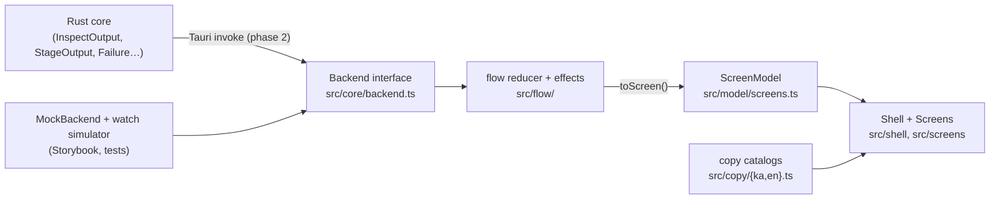
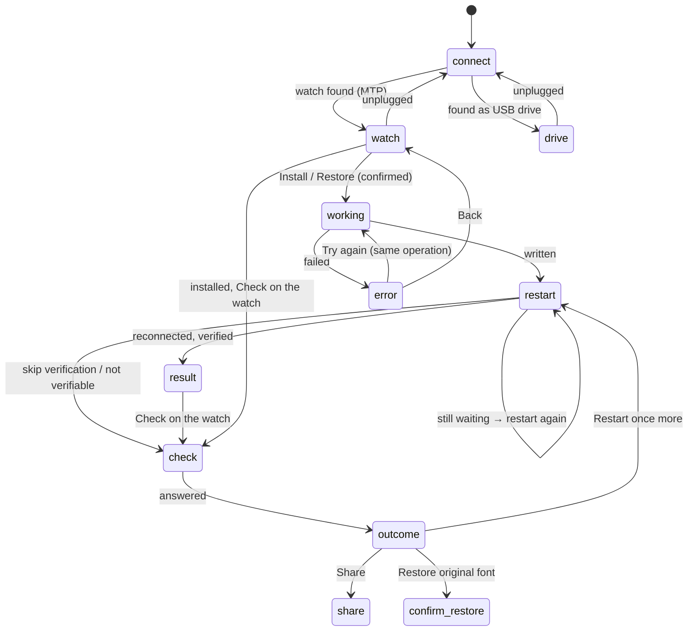

# Georgian for Garmin app: UI and flow contract

Status: phase 2. The app runs this UI over its Tauri commands (`TauriBackend`); the old `crates/app/ui/` is gone.
Evidence behind the decisions: a UX audit of v0.3.4 run in the demo build: every screen in both languages, the flow map, and 24 ranked findings. It was combined with the issues, comments, relayed emails and release download counts (#2–#46). This file is the authority for the new UI; change it before changing behaviour it describes.

## 1. Goal

The user's job has four steps:
1. Find out whether it works on their watch.
2. Get the app running.
3. Get Georgian to show on the watch.
4. Tell us how it went.

The current screens mirror the program's internals (packs, parts, staged files, support statuses) and drop the user between steps: after install the app stops watching the watch, never confirms Georgian arrived, offers actions it knows will fail, and buries the report under raw text.

The new UI is a guided journey: **Connect → Install → Restart → Check**. Each screen does one thing, with one main action. The app watches the device through the restart and confirms the result.

## 2. Rules every screen follows

1. **One main action per screen**, in a footer that never scrolls away. At most one secondary action next to it; everything else goes in **More**.
2. **Never offer an action the app knows will fail.** The actions come from the state (§5), not from a fixed button set.
3. **Plain words in the main flow.** Never shown there: pack, part, part number, ExtData, staged, `.tmp`, TrueType, bitmap, px, handle, or the names of the host fonts (Armenian, Hebrew, Korean, Nanum, Noto). They appear only under **More › What the app sees**. "MTP" appears only as the label the watch itself shows, with an explanation.
4. **One vocabulary** (§7), the same on every screen and in both languages.
5. **Georgian first.** Georgian is the default language. Both languages have the same keys, and the Georgian is written natively, not translated word for word.
6. **Honest and specific.** Name the model, as in "No one has confirmed Georgian on Lily 2 Active yet". Never promise what the project doesn't do.
7. **Nothing is sent without a click.** No telemetry. Reports go through GitHub only, and every share screen says that needs a free GitHub account.
8. **Native rendering only.** Never suggest other apps, widgets, images or transliteration.
9. **Accessible:**
   - text contrast ≥ 4.5:1, control boundaries ≥ 3:1;
   - body text ≥ 14 px, nothing below 13 px;
   - focus moves to the new screen's heading on every screen change;
   - status changes are announced in a polite live region, errors in `role="alert"`;
   - answer choices are real radio groups, and the keyboard reaches everything;
   - Enter triggers the main action where no other control has focus;
   - text is selectable, except on controls;
   - reduced motion is respected.
10. **Fits small windows.** The window becomes resizable, at 480×720 by default with a 420×560 minimum. Content scrolls above the fixed footer, so the main action is always visible.
11. **Light and dark** follow the system. Georgian text uses a bundled Noto Sans Georgian (OFL, from the lockfile), so it looks the same in WKWebView, WebView2 and WebKitGTK.

## 3. Architecture



- **Stack:** React + TypeScript (strict) + Vite, with Storybook (current stable, `@storybook/react-vite`) and Vitest. pnpm, with the Node toolchain from nixpkgs in the flake's dev shell. Code lives under `crates/app/frontend/`.
- **Types are generated, not hand-written.** `pnpm gen:types` runs `georgian-for-garmin --help --json` (a dev-shell build), takes each operation's `inputSchema`/`outputSchema`, adds the app's own command types from `georgian-for-garmin-app --schemas` (debug builds: `Failure`, `Progress`, `Shared`, `PhonePage`, `MarkPicture`, `ShareKey`, each deriving `JsonSchema` in `crates/app/src/`), and writes `src/core/types.gen.ts` with json-schema-to-typescript. CI regenerates the file and fails on any diff.
- **Fixtures come from the real core.** A Rust test, `crates/core/tests/ui_fixtures.rs`, builds fake watches from the replay reports in `crates/core/tests/reports/` and from the maintainer's Venu 2 fixtures. For each scenario in §8 it runs the real `inspect`, `install`, a simulated restart (the fake imports `.tmp` files), `inspect` again, `restore_stock`, `inspect_drive` and `issue_link`, and writes the JSON to `crates/app/frontend/fixtures/core/<scenario>/<step>.json`. With `GFG_WRITE_UI_FIXTURES=1` it writes the files; otherwise it compares them and fails on drift. `Failure` fixtures for busy holders and rollbacks come from the core's own error builders where they exist, otherwise they are hand-written and typed.
- **Screens are pure.** A screen is a function `(model: ScreenModel, copy, platform) => ScreenView`: its step, heading, content and its main and secondary actions. The Shell draws that view and builds the fixed footer from the actions. Screens hold no device logic and no timers.
- **The flow is a pure reducer** `(FlowState, FlowEvent) => FlowState`, plus an effect runner that calls the `Backend` and schedules polls. `toScreen(FlowState): ScreenModel` maps the flow's state to a screen model. The reducer, `verdictOf` and `toScreen` are unit-tested without React.

### 3.1 Backend interface (`src/core/backend.ts`)

Mirrors today's Tauri commands (`crates/app/src/main.rs`), with the same names and the core's output unchanged:

```ts
export interface Backend {
  inspect(): Promise<InspectOutput>;                  // rejects with Failure
  inspectDrive(): Promise<InspectDriveOutput>;
  install(onProgress?: (p: Progress) => void): Promise<StageOutput>;
  restoreStock(onProgress?: (p: Progress) => void): Promise<StageOutput>;
  issueLink(input: IssueLinkInput): Promise<IssueLink>;
  shareReport(input: IssueLinkInput): Promise<Shared>; // opens the browser (not in demo/mock)
  openIssue(issue: number): Promise<string>;
  openWatchList(): Promise<string>;                    // new (phase 2): the README's watch list; no arbitrary URLs
  phonePage(language: Lang): Promise<PhonePage>;
  testMarks(): Promise<MarkPicture[]>;                 // empty in stable builds
  platform(): Promise<Platform>;
  demoMode(): Promise<boolean>;
  savedLanguage(): Promise<Lang | null>;
  saveLanguage(language: Lang): Promise<void>;
  sharedBefore(key: ShareKey): Promise<boolean>;       // new (phase 2: app settings)
  markShared(key: ShareKey): Promise<void>;            // new (phase 2: app settings)
  diagnose(input: DiagnoseInput): Promise<DiagnoseOutput>; // core `diagnose` (§11); never rejects for device problems: they are data
  saveDiagnostics(text: string): Promise<string>;      // new (phase 2): writes to Downloads, returns the path
  copyText(text: string): Promise<void>;              // new (phase 2): the system clipboard
  revealFile(path: string): Promise<void>;            // new (phase 2): shows the file in Finder / Explorer / the file manager
}
// Generated from the app (types.gen.ts):
// Progress = { done: number; total: number }  (the core's progress, over a Tauri channel)
// ShareKey = { modelPart: string; software: string; result: Seen | "font_list" }
export type Lang = "ka" | "en";
export type Platform = "macos" | "windows" | "linux";
```

`sharedBefore` and `markShared` exist because 12 of the 29 issues are repeats: a user who has already shared a result for this watch and software sees a thank-you instead of being asked again. The key holds no unit ID.

## 4. The journey



**Polling:** `inspect` every 2 s on `connect`, `watch` and `restart`, and on `result` after a restore. When it fails with `no_device`, the app tries `inspectDrive` too. The app doesn't poll during `working`, `check`, `outcome` or `share`; on `error` it polls only after a `no_device` error, to notice the reconnect. The connect help card appears after 10 s without a watch.

**The same watch:** after a restart, the reconnected watch is the same one if `device.part_number` matches. Telling two watches of the same model apart is a non-goal.

### 4.1 The restart step, new

Install and restore end in **restart**, never in "Done". The phases are driven by polling:

| Phase | Shown when | Main text (en) | Action |
|---|---|---|---|
| `unplug` | right after writing, watch still connected | "Unplug the watch." | none: the app moves on when it sees the unplug |
| `restart` | unplug seen | Two numbered steps: "Hold the power button: choose Power Off, then turn the watch on again." and "Connect it again: the app checks that the watch loaded the font." | secondary: "I'll check on the watch" → `check` |
| `verifying` | reconnected | "Checking the watch…" | none |
| `again` | reconnected, `state` still `waiting` or `stock_waiting` | "The watch hasn't loaded the font yet. Restart it once more." | the next attempt starts automatically on unplug |
| `other_watch` | reconnected, different `part_number` | "This is a different watch. Connect the {model} again." | none |

- **Verified:** decided on the first successful `inspect` after the reconnect, with no extra read. "Checking the watch…" (`verifying`) shows only while that read takes more than 400 ms.
  - After an install: `installed`.
  - After a restore: nothing waits, and every restored part holds Garmin's font or nothing. The state may read `not_installed` or `unsupported`.
  - Either leads to `result`.
- **Still starting up:** in the first 10 s after a reconnect, `device_error` and `extdata_not_found` mean the watch is still starting: keep polling, and show `error` only after that.
- **`other` after reconnecting** leads to `watch` with the `blocked` verdict.
- **Not verifiable:** if every written pack is TrueType, the state doesn't change on restart. Then `verifiable` is false, the phase after `restart` is `check` (after a restore: `watch`), and the text doesn't ask the user to reconnect.
- **Skip:** "I'll check on the watch" goes to `check` after an install; after a restore the secondary reads "Skip" and goes to `watch`.
- **Busy while restarting:** if the reconnected watch is held by another program (Garmin Express often grabs it on reconnect), show the connect/busy screen without leaving the restart. When it's released, verification goes on with the same attempt, and the step indicator stays on Restart.
- **Drive while restarting:** if the watch comes back as a USB drive, `inspectDrive` is tried as on `connect`. The drive screen's "choose MTP" guidance shows without leaving the restart. When it's reconnected over MTP, verification goes on.
- **The attempt count** is shown from the second attempt on. After two `again` phases, the outcome offers sharing (§5.6).

## 5. Screens and their models (`src/model/screens.ts`)

This TypeScript is the contract between the flow and the screens. Change it here first.

```ts
import type { ErrorCode, BusyHolderKind, Reason } from "../core/types.gen";
import type { Lang, Platform } from "../core/backend";

/** `confirmedSoftware`: InspectOutput.tested.verified_software, the versions Georgian is confirmed on for this model ([] if none). */
export type WatchInfo = { model: string; modelPart: string; software: string; confirmedSoftware: string[] };
export type Confidence = "confirmed" | "confirmed_other_software" | "confirmed_some_fonts" | "unconfirmed";
export type Result = "georgian" | "boxes" | "question_marks" | "some_letters" | "no_notification" | "not_installed";
export type View = "popup" | "list" | "opened";
export type Answers = { result?: Result; views: View[]; phone?: "android" | "iphone"; marker?: string };
export type Op = "install" | "restore";
export type Localized = { ka: string; en: string };

export type Verdict =
  | { kind: "install"; confidence: Confidence; note?: "partly" | "beta" | "not_visible" }
  | { kind: "installed"; confidence: Confidence }
  | { kind: "restart_pending"; variant: "georgian" | "stock" }
  | { kind: "blocked"; reason: "waiting_other_font" | "unknown_font" }
  | { kind: "unsupported"; reason: Localized | null; restorable: boolean }
  | { kind: "no_font" }
  | { kind: "unreadable" };

export type BusyView = { kind: BusyHolderKind; name: string | null; confirmed: boolean };
export type ConnectProblem =
  | "permission_denied" | "multiple_devices" | "garmin_folder_not_found"
  | "extdata_not_found" | "device_error" | "internal";
export type RollbackView = { status: "complete" | "incomplete"; files: string[] };

export type ScreenModel =
  | { screen: "connect"; mode: "searching"; showHelp: boolean }
  | { screen: "connect"; mode: "busy"; busy: BusyView; duringRestart: boolean } // duringRestart: the step indicator stays on Restart
  | { screen: "connect"; mode: "problem"; problem: ConnectProblem; detail: string }
  | { screen: "drive"; watch: WatchInfo; driveOnly: boolean; issue: number | null; reportWanted: boolean; sharedBefore: boolean; duringRestart: boolean }
  | { screen: "watch"; watch: WatchInfo; verdict: Verdict; issue: number | null; reportWanted: boolean; sharedBefore: boolean }
  | { screen: "confirm_restore"; watch: WatchInfo }
  | { screen: "working"; op: Op; watch: WatchInfo; progress: { done: number; total: number } | null }
  | { screen: "restart"; op: Op; watch: WatchInfo; phase: "unplug" | "restart" | "verifying" | "again" | "other_watch"; attempt: number; verifiable: boolean }
  | { screen: "result"; op: Op; watch: WatchInfo; confidence: Confidence }
  | { screen: "check"; watch: WatchInfo; step: "send" | "answer"; answers: Answers; phone: { url: string; qr: string } | null; markPictures: { variant: string; picture: string }[] } // qr, picture: the core's data URLs
  | { screen: "outcome"; watch: WatchInfo; kind: "works_confirmed" | "works_first" | "didnt_show" | "no_notification"; restarts: number; sharedBefore: boolean; result: Result | null } // result: the answer given
  | { screen: "share"; watch: WatchInfo | null; what: "result" | "font_list" | "problem"; summary: { label: string; value: string }[]; reportText: string; state: "ready" | "opened" | "opened_paste" | "failed"; thanks: "tested_next" | "we_look" | null } // watch null: shared from connect (busy, problem)
  | { screen: "error"; op: Op; watch: WatchInfo; code: ErrorCode; rollback: RollbackView | null; detail: string }
  | { screen: "diagnostics"; summary: { label: string; value: string }[]; text: string; state: "collecting" | "ready" | "saved" | "copied" | "failed"; savedPath: string | null }; // from More; Back returns to the screen before

/** What the screen's buttons do. Screens emit these; only the flow acts on them. */
export type ActionId =
  | "install" | "restore" | "confirm_restore" | "cancel" | "check" | "skip_verify"
  | "send_test_done" | "answer" | "share" | "open_issue"
  | "restart_again" | "try_again" | "back" | "retry_now" | "done"
  | "copy_test_text" | "show_more" | "which_watches" | "help"
  | "diagnostics" | "save_diagnostics" | "copy_diagnostics" | "show_file";

/** Extra data some actions carry; every other action carries none. */
export type ActionPayload =
  | { action: "answer"; answers: Answers }   // the whole answer set after a change
  | { action: "share"; what: "result" | "font_list" | "problem" }; // the only way to share:
  // "Share the font list" and "Report this problem" are `share` with that `what`.

/** The More sheet: the flow supplies the data, the shell draws it. */
export type MoreModel = {
  restorable: boolean;                               // shows "Restore original font"
  seen: { label: string; value: string }[] | null;   // "What the app sees"; null with no watch
  reportText: string | null;                         // the exact report, copyable
  version: string;                                   // the app's version
};

/**
 * The app shell: header (language, More), the screen, the fixed footer with its actions.
 *   <Shell model={ScreenModel} more={MoreModel} lang={Lang} platform={Platform}
 *          overlayTitleBar?={boolean} demo?={boolean}
 *          onAction={(id: ActionId, payload?: ActionPayload) => void}
 *          onLanguage={(lang: Lang) => void} />
 * `overlayTitleBar`: the OS draws its window buttons over the toolbar (macOS, from the WebView's
 * user agent; defaults to `platform === "macos"`). `demo`: the demo build, named in More › About.
 * Restoring from More emits `restore`; the flow answers with `confirm_restore`.
 */
```

### 5.1 `verdictOf(InspectOutput): Verdict`

Pure and table-tested against every fixture. The first matching rule wins:

| # | When | Verdict |
|---|---|---|
| 1 | `support.status = unsupported` | `unsupported`, with `reason = support.reason`; `restorable` only if `restorable` and a part restore writes is seen holding our Georgian or an earlier build (`georgian`, `georgian_beta`). Otherwise Restore stays in More (`MoreModel.restorable = restorable`) without being the main action. |
| 2 | `state = unknown` | `unreadable` |
| 3 | `state = unsupported` (install writes nothing) | `no_font` |
| 4 | `state = waiting` / `stock_waiting` | `restart_pending` `georgian` / `stock` |
| 5 | `state = other` | `blocked`: `waiting_other_font` if a target part has a waiting file in the normal listing that is neither ours nor Garmin's, else `unknown_font` |
| 6 | `state = installed` | `installed` with `confidence` |
| 7 | `state ∈ {not_installed, partly, beta, not_visible}` | `install` with `confidence`, and `note` = the state unless it is `not_installed` |

**`confidence`:** `confirmed` if `support.status = tested`; else `confirmed_other_software` if `tested.status = tested_other_software`; else `confirmed_some_fonts` if at least one target part is tested; else `unconfirmed`.

### 5.2 What each screen says and offers

The wording here is guidance. The copy catalogs (§7) hold the final text in both languages.

| Screen | Says | Main action | Secondary |
|---|---|---|---|
| connect / searching | "Connect your watch with its USB cable." A one-line explanation of what the app does, the 4-step preview, and the help card after 10 s (Garmin Express, reconnect, choose MTP if the watch asks, data cable) | none | More |
| connect / busy | "{Program} is using your watch", with this platform's steps to free it (§6) | "Try again now" (it also retries every 2 s) | "Still stuck? Share what the app found" |
| connect / problem | a per-problem title and body (§6) | the problem's action (`permission_denied`: the Linux commands, copyable) | "Report this problem" |
| drive | "Your {model} is connected as a USB drive." If it can use MTP: how to switch on the watch. If `driveOnly`: "The app can't add Georgian to this watch yet." | MTP-capable: none (waits); drive-only: "Follow updates" (open the issue) | "Share the font list" if `reportWanted` and not `sharedBefore` |
| watch / install | Model and software. One line from `confidence`: "Georgian works on this watch" / "…confirmed with software {versions}, not yet {software}" / "No one has confirmed Georgian on {model} yet. If it doesn't show, one click puts Garmin's font back." One line for any `note` | **Install Georgian** | none |
| watch / installed | "Georgian is on your watch." If not `confirmed`: why a check helps, with the model's name | not confirmed: **Check on the watch**; confirmed: none ("You can unplug the watch") | confirmed: "Didn't work? Check on the watch" |
| watch / restart_pending | "The font is copied. Restart the watch to finish." | goes straight to `restart` (`unplug`) | none |
| watch / blocked | `waiting_other_font`: "Another font is waiting on the watch. Restart the watch, then connect it again." `unknown_font`: "Your watch uses a font the app doesn't recognise, so it changes nothing." | `waiting_other_font`: none, `restart` phases follow; `unknown_font`: "Share the font list" | none |
| watch / unsupported | "Georgian doesn't work on {model} yet." plus the reason | `restorable`: **Restore original font** ("an earlier test version left fonts on this watch"); else "Follow updates" | "Share the font list" if `reportWanted` |
| watch / no_font | "There's no Georgian font for {model} yet." | "Share the font list" (helps us look for one) | "Which watches work" |
| watch / unreadable | "The app couldn't read the watch's fonts." | "Try again" | "Report this problem" |
| confirm_restore | "Put Garmin's original font back? Georgian notifications will show as boxes again." | **Restore original font** | Cancel |
| working | "Installing Georgian…" / "Restoring Garmin's font…" Keep the watch connected. Progress when known | none | none |
| restart | §4.1 | per phase | per phase |
| result | install: "Georgian is on your watch." restore: "Garmin's font is back." | install, not confirmed: **Check on the watch**; confirmed: "Send a test notification" (optional); restore: none, but the app keeps reading the watch: unplugged → connect, another watch → its screen, the same one stays | none |
| check / send | "Send yourself a test notification": QR to the phone page, or the test text with a Copy button | "I sent it" | none |
| check / answer | "What did the watch show?" as a radio group with samples rendered in the app's own type: ქართ / □□□□ / ???? / ქა□□ / Nothing arrived. If letters: where they showed (optional checkboxes). Phone (optional). Beta builds only: the marker pictures | "Continue" (enabled once `result` is set; emits `done`, which on this step means "answers complete") | Back |
| outcome / works_confirmed | "Georgian works. Thanks!" | Done | none |
| outcome / works_first | "You're the first to confirm Georgian on {model}." Sharing tells every {model} owner | **Share the result** | "Not now" (keeps the answers for this session) |
| outcome / didnt_show | "Georgian didn't show." Also for "Some letters, some boxes": a partial result counts as not working. | `restarts < 2`: **Restart once more**; else **Share the result** | the other of those two; More › Restore |
| outcome / no_notification | Phone setup: Android (Garmin Connect notifications for the browser), iPhone (Home Screen page, iOS 16.4+) | "Try again" (back to send) | none |
| share | What's shared, as a short labelled list (model, software, what the app installed, your answers, the font list; no serial number or watch ID). "Show the exact text" is a collapsed disclosure in the content. "Needs a free GitHub account." | **Open GitHub** | none |
| share (after) | `opened`: "GitHub opened in your browser. Sign in if asked, check the form, then press Submit." `opened_paste`: plus "The report is copied: paste it into the empty Watch report box." Then the thanks line | Done | none |
| error | §6 | §6 | Back |

**More** is a sheet, reachable from the header on every screen. It holds:
- **Language:** the full words "ქართული" and "English".
- **Restore original font:** shown when `restorable`, and leads to `confirm_restore`.
- **What the app sees:** model, part number, software, what install writes (pack names and parts live here) and the report text, all copyable.
- **Help:** connecting, MTP, Garmin Express, phone setup.
- **Which watches work:** `openWatchList()` opens the README list.
- **About:** version, "Unofficial; not affiliated with Garmin", GitHub.

**Answers survive** leaving `check`, `outcome` or `share` for the rest of the session. "Done" never discards answers that haven't been shared without asking first.

## 6. Errors, busy and problems

| Code (op = install/restore) | Title (en) | Main action | Notes |
|---|---|---|---|
| `conflict` | "A font on the watch isn't Garmin's or ours" | "Share the font list" | Nothing was written |
| `restore_first` | "Put Garmin's font back first" | **Restore original font** | Then restart, then install |
| `verification_failed` | "The copy didn't check out" | **Try again** (the same operation) | Show the rollback (below) |
| `device_error` | "The watch stopped responding" | **Try again** | Show the rollback |
| `no_device` | "The watch was disconnected" | none: back to `connect`, and the app retries on reconnect | Show the rollback |
| `device_busy` | goes to connect / busy | | |
| `unsupported_device` | "There's nothing to change on this watch" | Back | |
| `internal`, `invalid_input`, `font_unavailable`, `extdata_not_found`, `garmin_folder_not_found` | "Something went wrong in the app" | **Report this problem** (share with the outcome) | `detail` under a disclosure |

- **"Try again" always repeats the failed operation**, never the start screen.
- **Rollback `incomplete`:** "Some files on the watch may not be as they were: {files}." Restore original font becomes the main action.
- **Busy text per platform**, with holder kinds `garmin_express`, `macos_camera_service`, `desktop_mtp`, `other` and `unknown`:
  - Never print a name twice ("Garmin Express (Garmin Express)" is a bug).
  - An `other` holder shows its process name once, in quotes. A 16-character macOS name is marked as cut off.
  - A name that isn't `confirmed` is phrased as "may be".
- **Connect problems.** A problem with a fix the user can do shows that fix and no Report:
  - `permission_denied` (Linux): the udev rule commands from `docs/command-line.md`, copyable;
  - `multiple_devices`: "Unplug all but one watch";
  - `device_error`: unplug and reconnect.

  A problem with no user fix (`garmin_folder_not_found`, `extdata_not_found`, `internal`) explains and offers **Report this problem**. Its report holds the app, the platform and the error, and no watch: the core's `issue_link` takes an `error` alone, as it takes `busy` alone.

## 7. Copy

- **Catalogs:** `src/copy/en.ts` and `src/copy/ka.ts` export the same typed shape, checked by the compiler and by a parity test. Keys are named by meaning (`watch.install.unconfirmed`), not by position.
  - Interpolation uses `{model}`, `{software}`, `{versions}` (from `confirmedSoftware`), `{files}`, `{program}`, `{done}`, `{total}` and `{attempt}`.
  - Platform variants are nested objects (`{ macos, windows, linux }`).
  - Sentences are never built by concatenating fragments.
- **Georgian:** natural Georgian, with suffixes attached to model names by a hyphen ("Lily 2 Active-ზე"). Button labels are verbal nouns, as in the current app ("ქართულის დაყენება").
- **The labels docs and release notes already cite stay as they are:** Install Georgian, Restore original font, Check on the watch, Share on GitHub.

| Concept | en | ka | Never |
|---|---|---|---|
| the program | the app | პროგრამა | |
| install | Install Georgian | ქართულის დაყენება | copy, stage |
| restore | Restore original font | ქარხნული შრიფტის დაბრუნება | |
| restart | restart the watch | საათის გადატვირთვა | reboot |
| phone notification | notification | შეტყობინება | use შეტყობინება for anything else |
| test message | test notification | სატესტო შეტყობინება | |
| the user's check | Check on the watch | საათზე შემოწმება | test (as a verb in buttons) |
| model-level proof | confirmed | დადასტურებული | tested, checked |
| send to us | share the result / Share on GitHub | შედეგის გაზიარება / GitHub-ზე გაზიარება | report (ka: რეპორტი, შეტყობინება) |
| what's shared | the watch's font list | საათის შრიფტების სია | report text, in the main flow |
| watch software | software {v} | სისტემის ვერსია {v} | ვერსია alone (reads as the app's version) |
| results | Georgian letters / boxes / question marks | ქართული ასოები / კვადრატები / კითხვის ნიშნები | |
| account | a free GitHub account | უფასო GitHub ანგარიში | |

## 8. Storybook

Run it with `nix develop -c pnpm -C crates/app/frontend storybook`.

**Toolbar globals:**
- language: ka, en;
- platform: macOS, Windows, Linux;
- theme: light, dark;
- window size: minimum 420×560, default 480×720, large 640×800, and short-screen 420×520.

Every story renders inside a frame of the chosen window size.

**`Screens/…`:** one story per row of this coverage list, each built from the generated fixtures:
- connect: searching (with and without help), busy (each holder kind × platform), and each problem;
- drive: switch to MTP, drive-only;
- watch: every verdict, every `confidence`, and every `note`;
- confirm_restore, and working (install and restore, with and without progress);
- restart: each phase, attempt 2, not verifiable;
- result: install (confirmed and unconfirmed) and restore;
- check: send, answer (empty, answered, beta marker);
- outcome: each kind, restarts 0 and 2, shared before;
- share: each `what` × `state`;
- error: each code group, rollback complete and incomplete;
- diagnostics: collecting, ready (no watch, watch found, busy), saved, copied, failed.

A test fails if a `ScreenModel` variant in this list has no story.

**`Flows/…`:** the full app (shell + reducer + `MockBackend`) with a **watch simulator** panel beside the window. The panel's buttons act out the physical side:
- Plug in (MTP), Plug in (drive), Unplug;
- Restart watch (imports waiting fonts);
- Garmin Express holds it, Release;
- Make the next write fail;
- the phone's result for the next check.

The flows:

| Flow | Fixture source | Shows |
|---|---|---|
| Venu 2, confirmed | maintainer Venu 2 | install → restart → verified → works (no share asked) |
| Lily 2 Active, first confirmation | the composed Lily fixture | short names, install → restart → check → works_first → share |
| Venu, boxes | issue-12 with a hidden listing (composed) | install → restart → check boxes → restart once more → share |
| Instinct 3, unsupported | issue-57 with 0.3.4's Korean font imported (composed) | unsupported, no install → restore → restart → restored |
| Venu 3, another font waiting | issue-2 + its waiting state | blocked → restart → install |
| fenix 6, unsupported | issue-6 | unsupported → follow updates; the beta-left variant → restore |
| Forerunner 245, drive only | issue-16 | drive-only → follow / share font list |
| Forerunner 265, no font | the demo watch | no_font → share font list |
| Garmin Express busy | any watch | busy → release → watch |
| Install fails, rollback incomplete | Venu 2 + write failure | error → restore |
| Linux permission denied | none | the problem screen with commands |
| Second restart needed | Venu 2 + a restart that doesn't import | again → attempt 2 → verified |
| Diagnostic info, watch not found | none (Garmin Express holds it) | More › Diagnostic info → save → show in folder → back |

**Tests run in CI:**
- Every flow has a play function, run headless in Chromium and WebKit through Storybook's Vitest addon.
- axe runs on every story, and any violation fails.
- Vitest covers the reducer (every transition), `verdictOf` (every fixture), `toScreen`, copy parity, and the "no internal words in the main flow" check: the main-flow copy keys may not contain the §2.3 words.

## 9. Phases and non-goals

**Phase 1 (done):**
- `crates/app/frontend/` with everything above, in Storybook and the tests;
- the flake's dev shell gets Node and pnpm;
- the Rust fixture test;
- CI runs type generation with a diff check, typecheck, Vitest and the story tests;
- `docs/development.md` gains a "Frontend and Storybook" section.

**Alongside, its own PR (done):** the core's `diagnose` operation and CLI command (§11).

**Phase 2 (done; the app ships this UI):**
- `TauriBackend` over `invoke`, with progress over a Tauri channel from the core's existing progress;
- `sharedBefore`/`markShared` in `settings.rs`;
- `saveDiagnostics`, `copyText` and `revealFile` as app commands;
- `JsonSchema` derives for the app-only types;
- `frontendDist` pointing at the Vite build, built by Tauri's before-commands and in CI and `release.yml`;
- the resizable window with its minimum size, and the overlay title bar on macOS (§10); the toolbar leaves room for the traffic lights by the OS drawing the window, not by `platform`, which the demo build can override;
- `index.html` checks the WebView before the app loads: an engine older than Safari 16.4's (no cascade layers, `@property`, `color-mix()`, container queries or media range syntax) gets a short ka/en message on how to update instead of a broken window;
- the demo build running the new UI over `demo.rs`, keeping the language and shares in memory and saying "Demo" in More › About;
- the old `ui/` deleted and the app tests ported.

**Non-goals:**
- no change to existing core operations;
- no email reporting in the app. Diagnostic info is saved or copied by the user, never sent;
- no telemetry;
- the GitHub issue form's language and the website ("does it work on my watch") are separate decisions;
- no telling apart two watches of the same model.

## 10. Visual design

The design is **direction B "Native & precise" with direction A's touches**: B's native structure and device drawing, plus A's warmth where it helps most.

- **Window:** native chrome per platform.
  - On macOS the app's toolbar is the title bar: the traffic lights sit over its left end, the step indicator is in the toolbar, and language and More are on the right. The app uses Tauri's overlay title bar with the title hidden; the traffic lights draw over all web content, so the More sheet opens below the toolbar there.
  - Windows gets a Windows 11 caption bar, Linux a GNOME header bar, above the same app.
- **Step indicator:** compact and segmented, in the toolbar. The current step is a raised segment with its name, done steps show a check, later steps their number.
- **Footer toolbar:** a status on the left (a spinner with "Looking for your watch…" or "Waiting for the watch…") and the buttons on the right in platform order: primary on the right on macOS and Linux, first on Windows. Native button sizes (32 px, 8 px corners, 5 px on Windows).
  - The footer is opaque enough that content scrolling under it never shows through behind its text. B's connect screen showed text through it; that's fixed.
- **Content:** System Settings-style grouped inset lists (12 px corners, hairline separators after the row icon, label and value rows), small graphite icon tiles, and badges for status. 20 px sides, 24 px between sections.
- **Palette:** neutral grays. One accent, a refined app-icon red, only on the main button, the current step, checked controls and the focus ring. Green means success. The tokens and contrast numbers are B's; none is pure black or white.
- **Type:** the system font for Latin, with Noto Sans Georgian always used for Georgian. Title 22/28, lead 15/22, body 14/20, labels 13/18. A model name and its suffix never break across lines.
- **The watch:** one realistic device drawing, reused everywhere, whose face shows the state (connecting, boxes, restarting, ქართ). The answer rows show mini watch faces.
- **A's touches:**
  - The install screen's picture is **before → after**: the watch with boxes becoming the watch with ქართ, and a notification bubble ("სალამი!"), drawn in B's device style.
  - The success outcomes (`works_confirmed`, `works_first`) get **restrained celebration**: a green check badge on the watch, a few confetti shapes, and a soft green tint behind the picture. All four steps show as done.
- **Motion:** purposeful and short, off with reduced motion. Text never fades in, so its contrast holds in every frame.
- **Copy:** B's copy changes (`src/design/b/copy.ts`) are adopted into `src/copy/{ka,en}.ts`, unless A's wording reads better.
  - Examples: "Your watch is ready for Georgian" / „საათი ქართულისთვის მზადაა", "Georgian works!" / „ქართული მუშაობს!" with the first-confirmation lead, and the two numbered restart steps.
  - On the outcome, "Your result" is a list: the watch, the software and what the watch showed (from `result`).
- **Structure:** connect has no footer More (More is in the toolbar), and "how it goes" is collapsible. Watch/install shows a Watch / Software / Georgian list with a status badge, and the way-back note below it. Restart is two numbered steps.

## 11. Diagnostic info

For when we reach out to someone who can't do something and can't use GitHub. Nothing is sent: the user saves or copies the info and attaches it to the conversation we're already having.

- **Where:** More › **Diagnostic info** („დიაგნოსტიკური ინფორმაცია"), on every screen, with or without a watch. It is not offered on the share screens.
- **Screen `diagnostics`:**
  - One line on what it's for: "If we ask you for diagnostic info, save it here and send it to us." Plus what it contains, and that it has no serial number or watch ID.
  - A summary list: app version, system, the watch found or not, the connection result, the last problem.
  - The full text, collapsed.
  - Main action **Save to file**: saved to Downloads as `georgian-for-garmin-diagnostics-<date>-<time>.txt`, then shown with "Show in folder". Secondary **Copy**. Back returns to where the user was.
- **The app's recent steps:** the flow keeps the last 50 events in memory: local time, kind (poll result, operation start and end, answer, share), the error code or state, the model. No identifiers. They're passed to `diagnose` as `events`.
- **Core operation `diagnose`:** read-only, idempotent, not destructive, no open world. Declared in `ops.rs` like the others, so it reaches the CLI (`georgian-for-garmin diagnose [--save <path>]`), `rpc` and `mcp`.
  - **Input:** `{ events?: Event[] }`.
  - **Output:**
    - `app`: version and build;
    - `system`: OS, OS version, architecture;
    - `usb`: **Garmin devices only** (vendor `0x091E`), each with product ID, product name, interface classes, and the holder from the busy detection when the system tells. Never USB serial numbers, never other vendors' devices;
    - `connection`: the result of a read-only connect attempt (`ok` or the error code and message, with `busy` when held);
    - `drives`: mounted volumes that look like a Garmin watch;
    - `watch`: the watch report (the same allowlisted report as `issue_link`'s) when the connection worked, else null;
    - `events`: the input, echoed;
    - `text`: all of the above as readable text.
  - **Single source:** `text` is the single source of the format and the masking. The first line states it contains no serial number or watch ID.
  - **Per platform:** macOS reads IOKit, Linux sysfs, Windows WPD's Garmin devices. Best effort, documented per platform.
  - **One connection per process:** `connection` goes through the same device access the process already uses, never a second, independent open.
    - In an `rpc`/`mcp` session it reuses the session's held connection (and its liveness probe), opening only when none is held.
    - In the app it runs through the shared `Watch` and its mutex, like `inspect`.
    - Only the standalone CLI opens fresh.
    - If the busy detection names this very process as the holder, it is reported as "this app", never as another program.
  - **Tests:** an identifier test like `fixtures_hold_no_identifiers` runs over the output.
