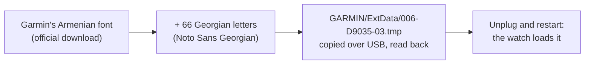
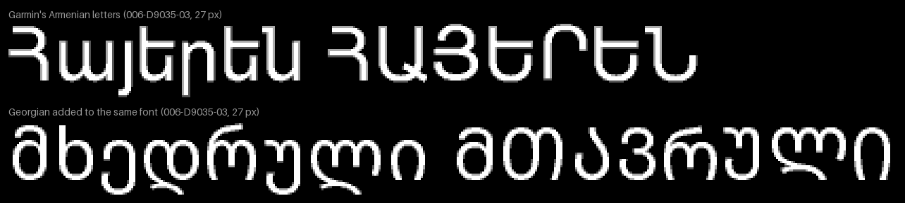

# How it works

## Why Georgian shows as boxes

Your phone forwards each notification's text to the watch over Bluetooth, unchanged: a trace of
a Venu 2 showed the Georgian letters arriving byte for byte. The watch then draws the text with
its fonts. Its built-in fonts have no Georgian letters, so it draws a box for each one.

The watch also loads optional fonts for other scripts (Armenian, Chinese, Japanese, Korean, Thai,
emoji) and looks up letters there when the built-in font doesn't have them. Adding Georgian to
one of those fonts is enough for notifications to show it.

## The watch's font folder

- **Which fonts a watch uses.** `GARMIN/GarminDevice.xml` on the watch lists its optional fonts as
  `MassStorageMode/UpdateFile` entries with `Path` `Garmin/ExtData`. A Venu 2 lists 21 of them;
  the Armenian font comes in four sizes, parts `006-D9035-01` to `-04` (21, 24, 27 and 31 px).
- **How a font gets onto the watch.** Garmin's updater copies a new font to
  `GARMIN/ExtData/<part>.tmp`. When the watch restarts it loads the file and deletes the `.tmp`.
  This project uses the same path; it doesn't modify firmware or any other file.
- **Which fonts get Georgian.** Every font part in [the registry](../fonts/README.md) that the
  watch lists, across all packs: Garmin ships its Armenian font as several products (NotoSans
  Regular, NotoSans Armenian Regular and Bold) in many sizes, and a watch may use parts of more
  than one. Each screen picks its own font and size (the Venu 2's notification pop-up uses
  27 px), so Georgian goes into every one the watch lists. Fonts the watch doesn't list are left
  alone.
- **Whether it was tested.** Each part counts as tested on a watch when its pack's `tested` list
  in the registry names that part for the watch's model part number and software version. The
  watch as a whole counts as tested only when every part it gets is.

## The font

Garmin's font files store each letter as a small bitmap: four grey levels, two bits per pixel.
A header gives the line height and baseline, a table maps Unicode ranges to glyphs, and a short
footer names the part and its version. The builder (`builder/`):

1. downloads Garmin's original file and checks its SHA-256;
2. measures the font's own Armenian letters and picks the Noto Sans Georgian size whose
   Mkhedruli x-height matches theirs (below);
3. draws each Georgian letter at that size on the font's line height and baseline, at the
   weight of its letters;
4. adds the ranges U+10D0–U+10F0 (Mkhedruli) and U+1C90–U+1CB0 (Mtavruli) and rebuilds the tables;
5. checks that every original letter, the missing-letter box and the footer are unchanged.

The build is reproducible: `nix build .#fonts` gives the same bytes on any machine.

### Letter size

A font's "27 px" is about the height of its Armenian capitals, not a font size. Georgian drawn
at 27 px came out about a quarter smaller than the text around it, so the builder measures the
2-bit bitmaps instead: the median height of ա ո ս ռ ւ (Armenian x-height), with antialiased
edge rows counted by their coverage. It draws Georgian at the size whose ა თ ი ო come closest;
in the 27 px font that is 34 px, with an x-height of 19 px like the Armenian (previously 15).
Noto's Georgian descenders are deeper than the Armenian ones the font's rows were made for,
so where they don't fit (14 of the 20 parts) the builder shortens only the part of each letter
below the baseline, to 82–97% of its designed length; the baseline doesn't move. The numbers
for every part are in [the font registry](../fonts/README.md#size).

## TrueType fonts (untested)

Many newer watches (Venu 3, Forerunner 165, fenix 6, Instinct 3) have no bitmap Armenian font,
but list TrueType fonts in `Garmin/ExtData` as `<part>.bin` files: Armenian, Hebrew, Arabic,
Chinese, Japanese, Korean, Thai. A `.bin` is an ordinary TrueType font with every byte XOR-ed
with `0x76`. The builder unmasks Garmin's file, appends Noto Sans Georgian's outlines, scaled to
the host's letters, keeps every original glyph, table and name, and masks it again. It adds
Georgian to the Noto Sans Armenian and Noto Sans Hebrew fonts and to the Swiss 721 Hebrew fonts
the fenix 6 and Instinct 3 list; [the font registry](../fonts/README.md#truetype-packs) says
why and how each is sized.

Only watches that list none of the registry's bitmap fonts get the TrueType ones. A watch with
bitmap Armenian fonts, such as the fenix 7 Pro, gets Georgian in those, as before, and its
TrueType fonts are left as Garmin made them; `inspect` says which kind a watch gets and why.
`inspect` reads only files that may be this build's (named for one of its parts, with the size
of its original or Georgian version), so the app's polling never transfers the watch's
multi-megabyte Chinese, Japanese or Korean fonts.

Garmin's update catalog installs these as `GARMIN/ExtData/<part>.bin` and marks them as needing
no restart. MTP has no way to overwrite a file in place, so the installer deletes the watch's
`.bin` and writes the new one under the same name, then reads it back. The steps that keep this
safe:

- It replaces a `.bin` only when it holds Garmin's original byte for byte (the same file the
  registry pins by SHA-256) or this build's Georgian font, and only when `GarminDevice.xml`
  lists the part at the version and file name the build carries. Anything else, or two files
  under the name, stops the whole install before anything is written.
- Where the watch shows no `.bin` for a part it lists, the file is created, as Garmin's
  updater would.
- The original bytes are read from the watch before anything is written. If any part fails,
  in any pack, each replaced `.bin` is written back from them and read back, and new `.tmp`
  files are deleted; the error says what happened to each file.
- Restoring writes Garmin's original, bundled in the app, the same way.

Unplugging and restarting the watch afterwards is still the instruction: the watch may only
reload its fonts then. Whether these watches draw Georgian from these fonts hasn't been seen on
a watch yet; each part counts as untested until a report says it does.

## The hidden folder

When `GARMIN/ExtData` is empty, the watch leaves it out of its folder listing, and asking the
watch to create it fails. The installer finds it without guessing:

1. a folder named `ExtData` under `GARMIN`, if listed;
2. otherwise the parent of a font file already waiting there;
3. otherwise the first 32 object handles after the `GARMIN` folder's, read one by one (on the
   Venu 2 it's `0x01000009`);
4. otherwise, if the watch lists Garmin's vendor operation `GetObjectIds` (`0x9002`), the
   children it reports for `GARMIN`. Unlike `GetObjectHandles`, it includes the ones listings
   leave out: on the tactix 7 it reports `ExtData` as `0x01000021`, one past the probe.

A candidate counts only if it's named `ExtData`, is a folder, sits under `GARMIN` and is on the
same storage. If none matches, nothing is written.

## Copying files safely

- Every target, in every pack, is checked before anything is written. A file already waiting
  with the same bytes is skipped; one with different bytes stops the whole install, and nothing
  changes.
- Each file is read back after copying and compared byte for byte.
- If any part fails, the files that run copied, in any pack, are deleted again; files from
  earlier runs stay.
- The Venu 2 expects the 12-byte header of each data transfer on its own, separately from the
  data, as libmtp sends it. Sending both in one USB transfer freezes its MTP connection. The
  installer detects this from the watch's replies, and recovers a watch left frozen by an earlier
  failed transfer (a USB reset at most).

## Windows

On Windows the installer uses Windows' built-in MTP driver (Windows Portable Devices); nothing
needs to be installed or replaced. The driver opens the hidden folder directly by its object ID
(`o1000009` on the Venu 2). The command-line installer was tested this way with a Venu 2 from a
Windows 11 on Arm virtual machine: it found the folder, copied all four sizes and read them back.

## What has been tested

| Test | Watch | Result |
|---|---|---|
| All four sizes installed, Telegram and SMS notifications | Venu 2, 19.05 | Georgian in the pop-up, the notification list and opened notifications |
| Original 27 px font restored | Venu 2, 19.05 | Boxes again in the pop-up |
| Text sent from Android (Bluetooth trace) | Venu 2, 19.05 | Georgian bytes arrive unchanged |
| `install` from Windows 11 on Arm (virtual machine) | Venu 2, 19.05 | All four files copied and read back through the built-in driver |
