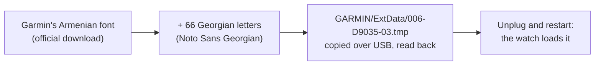

# How it works

## Why Georgian shows as boxes

Your phone forwards each notification's text to the watch over Bluetooth, unchanged: a trace of
a Venu 2 showed the Georgian letters arriving byte for byte. The watch then draws the text with
its fonts. Its built-in fonts have no Georgian letters, so it draws a box for each one.

The watch also loads optional fonts for other scripts (Armenian, Chinese, Japanese, Korean, Thai,
emoji) and looks up letters there when the built-in font doesn't have them. Adding Georgian to
one of those fonts is enough for notifications to show it.

## The watch's font folder

- **Which fonts a watch uses.** `GARMIN/GarminDevice.xml` on the watch lists its optional fonts as
  `MassStorageMode/UpdateFile` entries with `Path` `Garmin/ExtData`. A Venu 2 lists 21 of them;
  the Armenian font comes in four sizes, parts `006-D9035-01` to `-04` (21, 24, 27 and 31 px).
- **How a font gets onto the watch.** Garmin's updater copies a new font to
  `GARMIN/ExtData/<part>.tmp`. When the watch restarts it loads the file and deletes the `.tmp`.
  This project uses the same path; it doesn't modify firmware or any other file.
- **Which font the watch picks.** The first font pack in [the registry](../fonts/README.md) that
  the watch lists. Georgian goes into every size of that pack, because other screens may use other
  sizes (the Venu 2's notification pop-up uses 27 px).

## The font

Garmin's font files store each letter as a small bitmap: four grey levels, two bits per pixel.
A header gives the line height and baseline, a table maps Unicode ranges to glyphs, and a short
footer names the part and its version. The builder (`builder/`):

1. downloads Garmin's original file and checks its SHA-256;
2. draws each Georgian letter from Noto Sans Georgian at the font's own size, line height and
   baseline;
3. adds the ranges U+10D0–U+10F0 (Mkhedruli) and U+1C90–U+1CB0 (Mtavruli) and rebuilds the tables;
4. checks that every original letter, the missing-letter box and the footer are unchanged.

The build is reproducible: `nix build .#fonts` gives the same bytes on any machine, and the
27 px font is byte-identical to the one first tested on a watch.

## The hidden folder

When `GARMIN/ExtData` is empty, the watch leaves it out of its folder listing, and asking the
watch to create it fails. The installer finds it without guessing:

1. a folder named `ExtData` under `GARMIN`, if listed;
2. otherwise the parent of a font file already waiting there;
3. otherwise the first 32 object handles after the `GARMIN` folder's, read one by one (on the
   Venu 2 it's `0x01000009`).

A candidate counts only if it's named `ExtData`, is a folder, sits under `GARMIN` and is on the
same storage. If none matches, nothing is written.

## Copying files safely

- Every target is checked before anything is written. A file already waiting with the same bytes
  is skipped; one with different bytes stops the whole install, and nothing changes.
- Each file is read back after copying and compared byte for byte.
- If any size fails, the files that run copied are deleted again; files from earlier runs stay.
- The Venu 2 expects the 12-byte header of each data transfer on its own, separately from the
  data, as libmtp sends it. Sending both in one USB transfer freezes its MTP connection. The
  installer detects this from the watch's replies, and recovers a watch left frozen by an earlier
  failed transfer (a USB reset at most).

## Windows

On Windows the installer uses Windows' built-in MTP driver (Windows Portable Devices); nothing
needs to be installed or replaced. The driver opens the hidden folder directly by its object ID
(`o1000009` on the Venu 2). The command-line installer was tested this way with a Venu 2 from a
Windows 11 on Arm virtual machine: it found the folder, copied all four sizes and read them back.

## What has been tested

| Test | Watch | Result |
|---|---|---|
| All four sizes installed, Telegram and SMS notifications | Venu 2, 19.05 | Georgian in the pop-up, the notification list and opened notifications |
| Original 27 px font restored | Venu 2, 19.05 | Boxes again in the pop-up |
| Text sent from Android (Bluetooth trace) | Venu 2, 19.05 | Georgian bytes arrive unchanged |
| `install` from Windows 11 on Arm (virtual machine) | Venu 2, 19.05 | All four files copied and read back through the built-in driver |
