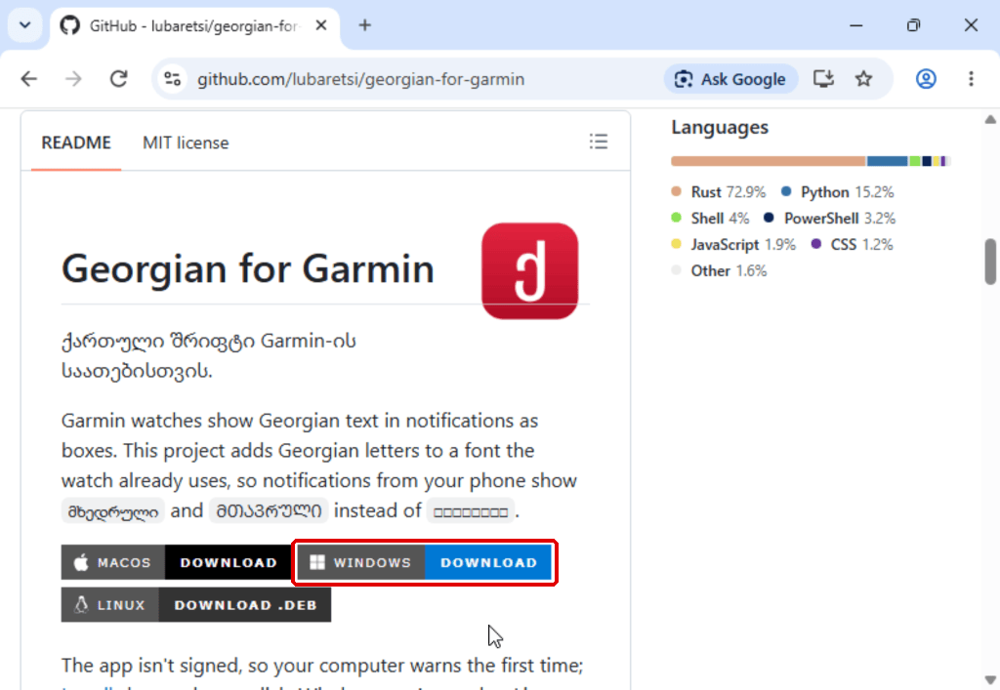
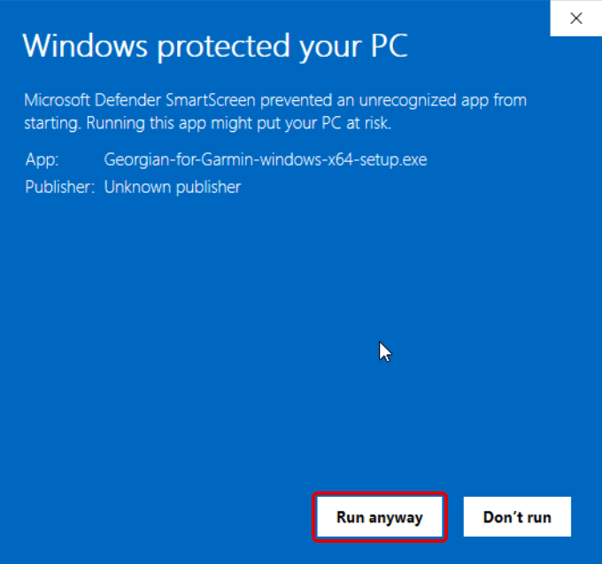
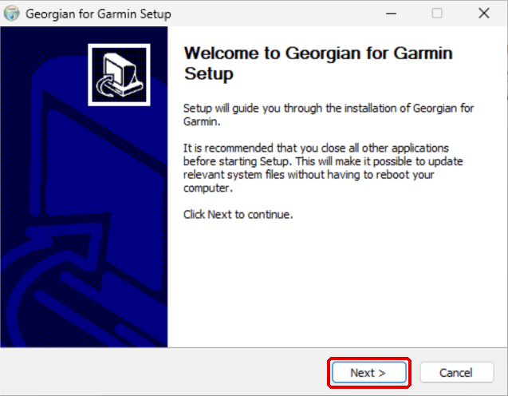
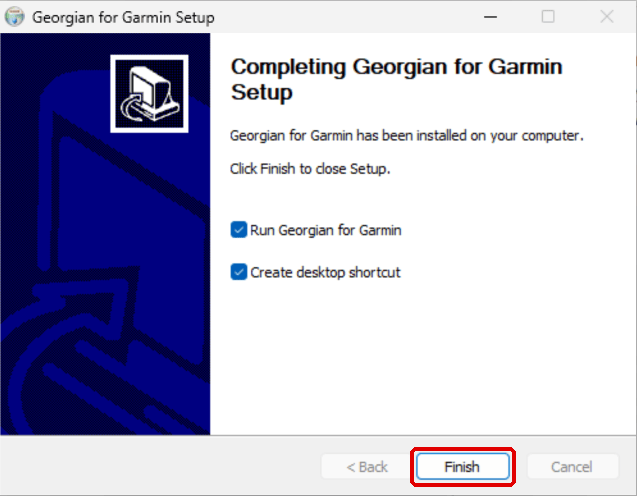
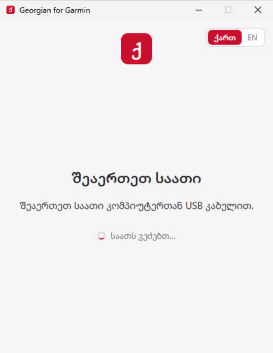
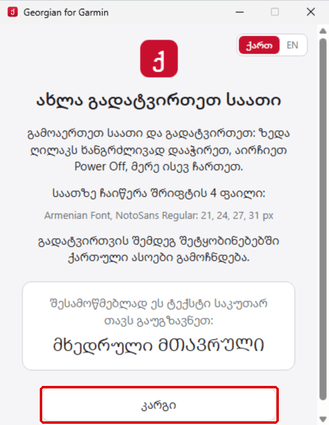

# Windows-ზე დაყენება, ნაბიჯ-ნაბიჯ

ამ ინსტრუქციით Georgian for Garmin-ს Windows 10-ზე ან 11-ზე დააყენებთ და საათზე ქართულ ასოებს
ჩაწერთ. დაგჭირდებათ საათის USB კაბელი. სურათები Windows 11-ზე და Google Chrome-შია
გადაღებული.

მთელი დაყენება 46 წამში:

https://github.com/user-attachments/assets/c4adbad8-d956-4ab3-ba71-5f67e415e6df

## 1. ჩამოტვირთეთ პროგრამა

გახსენით Google Chrome და შედით გვერდზე
[github.com/lubaretsi/georgian-for-garmin](https://github.com/lubaretsi/georgian-for-garmin).
დააჭირეთ **WINDOWS**-ის გვერდით ღილაკს **DOWNLOAD**.



## 2. გახსენით ფაილი

ჩამოტვირთვა რომ დასრულდება, Chrome ზედა მარჯვენა კუთხეში რამდენიმე წამით აჩვენებს ფაილს.
დააჭირეთ მას. თუ უკვე გაქრა, დააჭირეთ ზედა მარჯვენა კუთხეში ჩამოტვირთვების ისარს, მერე
ფაილს.


თუ Chrome **Done**-ის ნაცვლად გაფრთხილებას აჩვენებს, დააჭირეთ გაფრთხილებას და აირჩიეთ ფაილის
შენახვა.

## 3. Windows-ის გაფრთხილება

გამოჩნდება ლურჯი ფანჯარა **Windows protected your PC**. დააჭირეთ **More info**-ს.


მერე დააჭირეთ ღილაკს **Run anyway**.



Windows ამას იმიტომ აჩვენებს, რომ პროგრამას ციფრული ხელმოწერა არ აქვს, ამიტომ გამომცემელს
ვერ ცნობს (**Unknown publisher**). Georgian for Garmin ღია კოდის პროგრამაა: მისი მთელი კოდი
ამ გვერდზეა.

## 4. დააყენეთ

დაყენების ფანჯარა შეიძლება რამდენიმე წამში გაიხსნას. დააჭირეთ ღილაკს **Next**.



შემდეგ ორ ფანჯარაშიც დააჭირეთ **Next**-ს. ადმინისტრატორის პაროლი არ დაგჭირდებათ. ბოლო
ფანჯარაში **Run Georgian for Garmin** მონიშნული დატოვეთ და დააჭირეთ **Finish**-ს.



## 5. გახსენით პროგრამა

პროგრამა გაიხსნება და დაწერს **შეაერთეთ საათი**. შემდეგ ჯერზე პროგრამა სამუშაო მაგიდიდან
გახსენით, **Georgian for Garmin**-ის ხატულით.



## 6. ჩაწერეთ ქართული საათზე

თუ Garmin Express გახსნილია, დახურეთ. შეაერთეთ საათი კომპიუტერთან USB კაბელით. თუ საათი
შეერთების ხერხს გკითხავთ, აირჩიეთ MTP. პროგრამა საათის სახელს და ვერსიას აჩვენებს. დააჭირეთ
ღილაკს **ქართულის დაყენება**.


ჩაწერას რამდენიმე წამი სჭირდება. ამ დროს საათს ნუ გამოაერთებთ.

## 7. გადატვირთეთ საათი

როცა პროგრამა დაწერს **ახლა გადატვირთეთ საათი**, გამოაერთეთ საათი და გადატვირთეთ: ზედა
ღილაკს ხანგრძლივად დააჭირეთ, აირჩიეთ **Power Off**, მერე ისევ ჩართეთ. პროგრამაში დააჭირეთ
ღილაკს **კარგი**.



## 8. შეამოწმეთ

საკუთარ თავს გაუგზავნეთ ეს ტექსტი, მაგალითად SMS-ით ან ელფოსტით, რომ საათზე შეტყობინებად
გამოჩნდეს:

```text
მხედრული ᲛᲗᲐᲕᲠᲣᲚᲘ
```

კვადრატების ნაცვლად ქართული ასოები უნდა დაინახოთ.

## წაშლა

საათზე ქარხნული შრიფტის დასაბრუნებლად შეაერთეთ საათი, დააჭირეთ ღილაკს
**ქარხნული შრიფტის დაბრუნება**, მერე გამოაერთეთ და გადატვირთეთ. პროგრამის კომპიუტერიდან
წასაშლელად გახსენით **Settings → Apps → Installed apps**, მოძებნეთ Georgian for Garmin,
დააჭირეთ **⋯**-ს და აირჩიეთ **Uninstall**. დაადასტურეთ და გახსნილ ფანჯარაშიც დააჭირეთ
**Uninstall**-ს.


