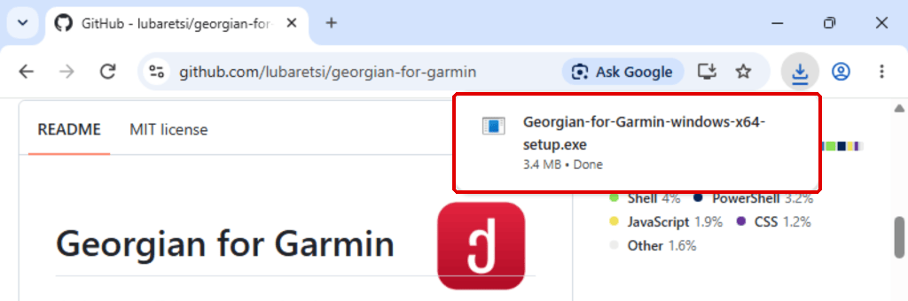
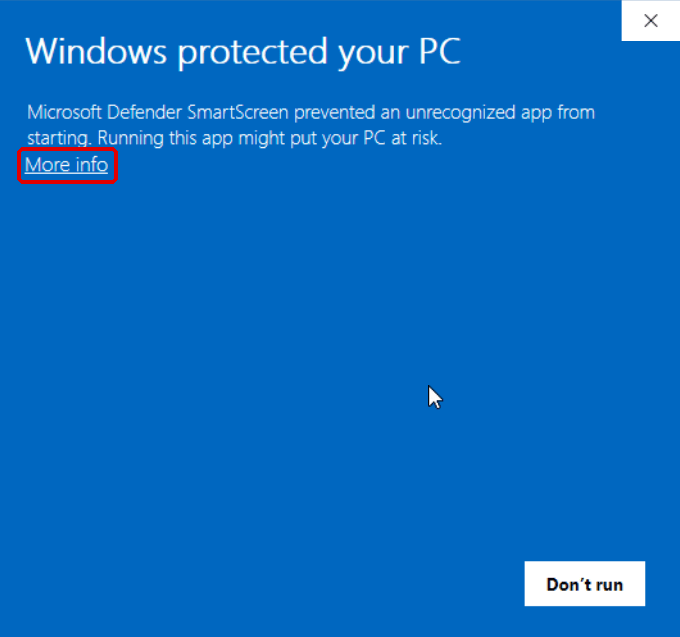
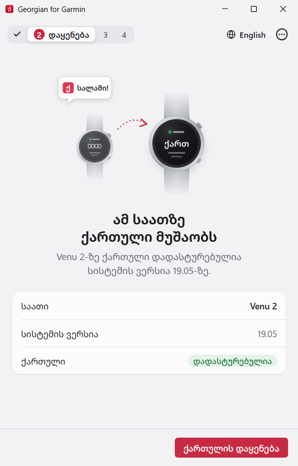
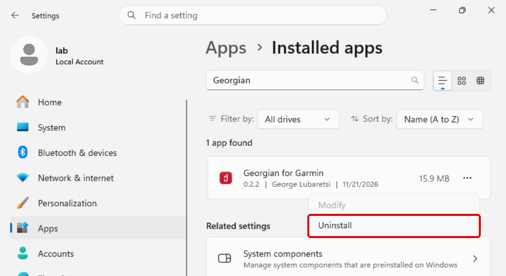

# Windows-ზე დაყენება, ნაბიჯ-ნაბიჯ

ამ ინსტრუქციით Georgian for Garmin-ს Windows 10-ზე ან 11-ზე დააყენებთ და საათზე ქართულ ასოებს
ჩაწერთ. დაგჭირდებათ საათის USB კაბელი. სურათები Windows 11-ზე და Google Chrome-შია
გადაღებული.

მთელი დაყენება 46 წამში:

https://github.com/user-attachments/assets/c4adbad8-d956-4ab3-ba71-5f67e415e6df

## 1. ჩამოტვირთეთ პროგრამა

გახსენით Google Chrome და შედით გვერდზე
[github.com/lubaretsi/georgian-for-garmin](https://github.com/lubaretsi/georgian-for-garmin).
დააჭირეთ **WINDOWS**-ის გვერდით ღილაკს **DOWNLOAD**.


## 2. გახსენით ფაილი

ჩამოტვირთვა რომ დასრულდება, Chrome ზედა მარჯვენა კუთხეში რამდენიმე წამით აჩვენებს ფაილს.
დააჭირეთ მას. თუ უკვე გაქრა, დააჭირეთ ზედა მარჯვენა კუთხეში ჩამოტვირთვების ისარს, მერე
ფაილს.



თუ Chrome **Done**-ის ნაცვლად გაფრთხილებას აჩვენებს, დააჭირეთ გაფრთხილებას და აირჩიეთ ფაილის
შენახვა.

## 3. Windows-ის გაფრთხილება

გამოჩნდება ლურჯი ფანჯარა **Windows protected your PC**. დააჭირეთ **More info**-ს.



მერე დააჭირეთ ღილაკს **Run anyway**.


Windows ამას იმიტომ აჩვენებს, რომ პროგრამას ციფრული ხელმოწერა არ აქვს, ამიტომ გამომცემელს
ვერ ცნობს (**Unknown publisher**). Georgian for Garmin ღია კოდის პროგრამაა: მისი მთელი კოდი
ამ გვერდზეა.

## 4. დააყენეთ

დაყენების ფანჯარა შეიძლება რამდენიმე წამში გაიხსნას. დააჭირეთ ღილაკს **Next**.


შემდეგ ორ ფანჯარაშიც დააჭირეთ **Next**-ს. ადმინისტრატორის პაროლი არ დაგჭირდებათ. ბოლო
ფანჯარაში **Run Georgian for Garmin** მონიშნული დატოვეთ და დააჭირეთ **Finish**-ს.


## 5. გახსენით პროგრამა

პროგრამა გაიხსნება და დაწერს **შეაერთეთ საათი USB კაბელით**. შემდეგ ჯერზე პროგრამა სამუშაო
მაგიდიდან გახსენით, **Georgian for Garmin**-ის ხატულით.

<!-- RETAKE: old UI; see images/RETAKE.md -->


## 6. დააყენეთ ქართული საათზე

თუ Garmin Express გახსნილია, დახურეთ. შეაერთეთ საათი კომპიუტერთან USB კაბელით. თუ საათი
შეერთების ხერხს გკითხავთ, აირჩიეთ MTP. თუ Garmin Express ან სხვა პროგრამა საათს იყენებს,
პროგრამა გეტყვით, რომელი და როგორ დახუროთ. როცა საათს იპოვის, მის სახელსა და სისტემის ვერსიას
აჩვენებს. დააჭირეთ ღილაკს **ქართულის დაყენება**.

<!-- RETAKE: old UI; see images/RETAKE.md -->


დაყენებას რამდენიმე წამი სჭირდება. ამ დროს საათს ნუ გამოაერთებთ.

## 7. გადატვირთეთ საათი

პროგრამა დაწერს **გადატვირთეთ საათი** და ნაბიჯებს გაჩვენებთ: გამოაერთეთ საათი, ჩართვის
ღილაკს ხანგრძლივად დააჭირეთ, აირჩიეთ **Power Off**, მერე ისევ ჩართეთ და კომპიუტერს
შეუერთეთ. პროგრამა თავად ამოწმებს, ჩატვირთა თუ არა საათმა ახალი შრიფტი. თუ ჯერ არ ჩატვირთა,
გთხოვთ, კიდევ ერთხელ გადატვირთოთ.

<!-- RETAKE: old UI; see images/RETAKE.md -->


## 8. შეამოწმეთ

პროგრამაში დააჭირეთ ღილაკს **საათზე შემოწმება**. ტელეფონით დაასკანერეთ ეკრანზე გამოსული კოდი
და დააჭირეთ **სატესტო შეტყობინების გაგზავნას**, ან საკუთარ თავს გაუგზავნეთ ეს ტექსტი,
მაგალითად SMS-ით ან ელფოსტით:

```text
Test მხედრული ᲛᲗᲐᲕᲠᲣᲚᲘ Test
```

მერე პროგრამაში დააჭირეთ **გავაგზავნე** და მონიშნეთ, რა გამოჩნდა საათზე. კვადრატების ნაცვლად
ქართული ასოები უნდა დაინახოთ. თუ თქვენი საათის მოდელზე ქართული ჯერ არავის დაუდასტურებია,
პროგრამა შედეგის გაზიარებას შემოგთავაზებთ: **GitHub-ის გახსნა** ბრაუზერში GitHub-ის გვერდს
შევსებულს გახსნის, თქვენ მხოლოდ გადახედავთ და გამოაქვეყნებთ. ასე ვიგებთ, რომელ საათზე
მუშაობს ქართული.

თუ რამე არ გამოვიდა და დიაგნოსტიკურ ინფორმაციას გთხოვთ, დააჭირეთ ზედა მარჯვენა კუთხეში
**⋯**-ს და აირჩიეთ **დიაგნოსტიკური ინფორმაცია**: იქ მას ფაილად შეინახავთ ან დააკოპირებთ. მასში
არც სერიული ნომერია, არც საათის ID.

## წაშლა

საათზე ქარხნული შრიფტის დასაბრუნებლად შეაერთეთ საათი, დააჭირეთ ზედა მარჯვენა კუთხეში **⋯**-ს და
აირჩიეთ **ქარხნული შრიფტის დაბრუნება**. მერე საათი ისე გადატვირთეთ, როგორც პროგრამა
გაჩვენებთ. პროგრამის კომპიუტერიდან წასაშლელად გახსენით **Settings → Apps → Installed apps**,
მოძებნეთ Georgian for Garmin, დააჭირეთ **⋯**-ს და აირჩიეთ **Uninstall**. დაადასტურეთ და
გახსნილ ფანჯარაშიც დააჭირეთ **Uninstall**-ს.


